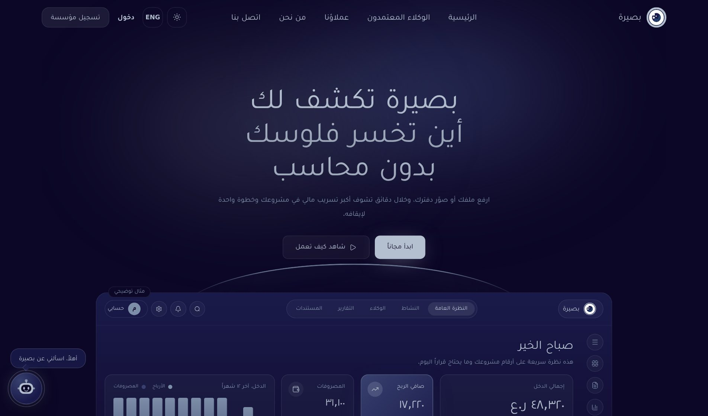
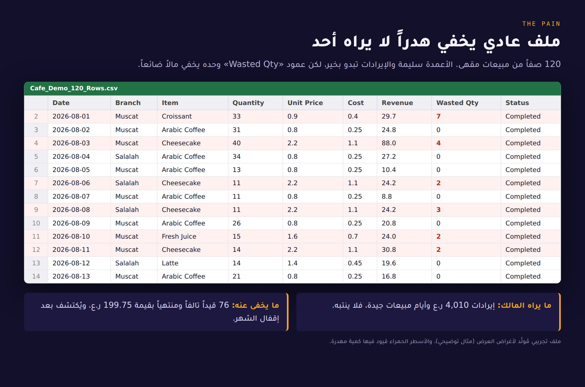
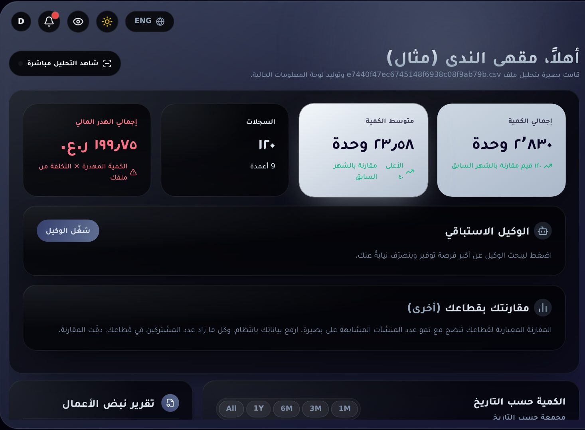
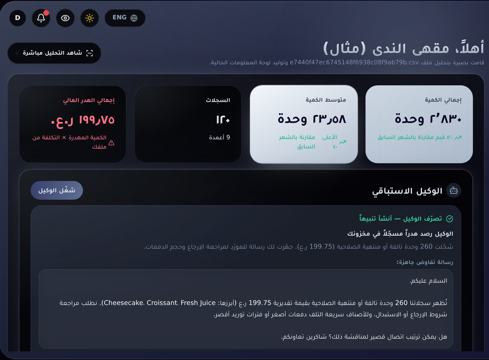
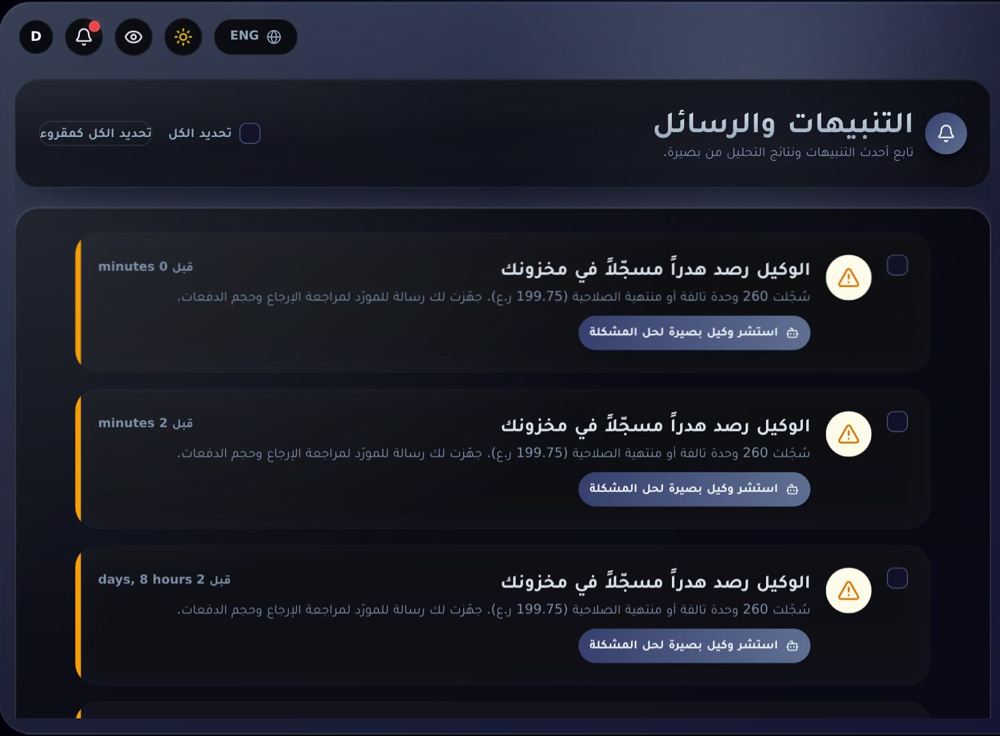
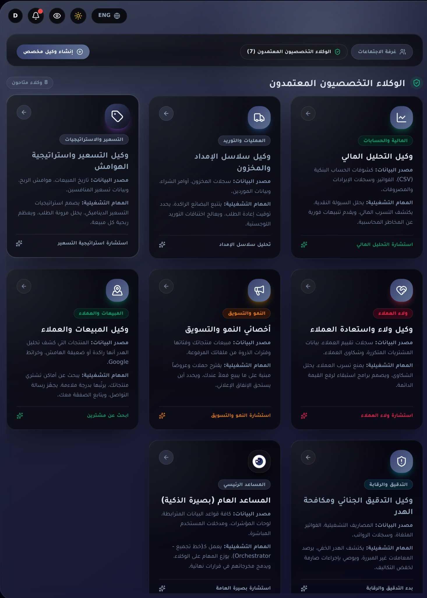

# بصيرة · Baseera

### تكشف لك أين تخسر فلوسك، وتجهّز لك القرار

منصة ذكاء مالي للمنشآت الصغيرة والمتوسطة في سلطنة عُمان.
ترفع ملفك أو صورة دفترك، فتحسب بصيرة الهدر والسيولة والمخاطر من أرقامك أنت، ثم تنبّهك وتجهّز الرسالة.

 

---

> **هذا المستودع تعريفي فقط.** لا يحتوي الشيفرة المصدرية ولا يتيح استخدام المنصة. للاطلاع على التجربة أو الشراكة، راجع قسم [التواصل](#التواصل).

## مسابقة «هندسها بالذكاء الاصطناعي»

شاركت بصيرة في مسابقة **«هندسها بالذكاء الاصطناعي»** التي أقيمت في **مدار** بالتعاون مع **وزارة النقل والاتصالات وتقنية المعلومات**.

## المشكلة

صاحب المقهى أو البقالة أو محل الجملة يدير كل شيء بنفسه. مبيعاته في ملف Excel، وكشف حسابه في PDF، وإيصالاته في صور على الهاتف، ودفتره بخط اليد.
لا وقت لديه ليحلل هذه الأرقام، فيعرف الهدر **بعد** إقفال الشهر لا قبله: صنف يتلف كل أسبوع، ومورّد يرفع السعر، وعميل بالآجل يتأخر.

> مثال توضيحي من ملف تجريبي مُولَّد (120 صفاً): الإيرادات 4,010 ر.ع تبدو بخير، لكن عمود «Wasted Qty» يخفي هدراً بقيمة 199.75 ر.ع (4.98% من الإيرادات).

## كيف تحلّها بصيرة

بعد رفع الملف مباشرة تعرض بصيرة الرقم الحقيقي، ثم يتصرف الوكيل نيابة عن المالك:

<table>
<tr>
<td width="50%"></td>
<td width="50%"></td>
</tr>
<tr>
<td align="center"><b>1. الرقم الحقيقي</b> هدر 199.75 ر.ع محسوب من الكمية المهدرة × التكلفة في ملفك.</td>
<td align="center"><b>2. الوكيل يتصرّف</b> يرصد أكبر فرصة توفير، وينشئ تنبيهاً، ويجهّز رسالة مفاوضة بالأرقام الفعلية.</td>
</tr>
</table>

مسودة الرسالة التي يجهّزها الوكيل (أرقامها من صفوف المالك، ولا يرسل شيئاً من تلقاء نفسه):

> السلام عليكم،
> تُظهر سجلاتنا 260 وحدة تالفة أو منتهية الصلاحية بقيمة تقديرية 199.75 ر.ع (أبرزها: Cheesecake، Croissant، Fresh Juice). نطلب مراجعة شروط الإرجاع أو الاستبدال، وللأصناف سريعة التلف دفعات أصغر أو فترات توريد أقصر.
> هل يمكن ترتيب اتصال قصير لمناقشة ذلك؟ شاكرين تعاونكم.

## ثمانية وكلاء، وقاعدة واحدة

منسّق عام و7 وكلاء متخصصين يعملون على بيانات المالك نفسها، ويمكن جمعهم في «لجنة» تتناقش وتدمج مخرجاتها.

| الوكيل | ماذا يفعل |
|---|---|
| المساعد العام | يوزّع المهام ويدمج مخرجات الوكلاء في قرار |
| الوكيل المالي | السيولة والتدفق النقدي والتسرّب المالي |
| سلاسل الإمداد | المخزون الراكد والموردون وتوقيت إعادة الطلب |
| التسعير والهوامش | ربحية كل صنف ومرونة الطلب |
| التدقيق ومكافحة الهدر | الهدر الخفي والمعاملات المتكررة وغير المبررة |
| ولاء العملاء | الاستبقاء والشكاوى |
| المبيعات والعملاء | يبحث عن مشترين جدد ويجهّز رسالة التواصل |
| النمو والتسويق | حملات وعروض مبنية على ما يُباع فعلاً |

**القاعدة التي تحكم كل شيء:** الأرقام تُحسب بالشيفرة من بيانات المالك، والذكاء الاصطناعي يصوغ النص فقط، وأي رقم لا يرد في بياناته يُرفض. وكل إجراء يتم بنقرة من المالك، ولا يُرسل شيء لمورّد أو عميل تلقائياً.

## ماذا تقدم بصيرة

- **كشف الهدر** والمخزون الراكد بقيمته بالريال.
- **الإنذار المبكر للبيع بالآجل:** مؤشرات مخاطر العميل قبل أن تبيع له.
- **المدرج النقدي والتدفق النقدي:** كم شهراً تكفي السيولة.
- **قراءة الصور والمستندات الممسوحة:** إيصالات وكشوف وصور دفاتر تتحول إلى صفوف.
- **واتساب:** أرسل ملفاً أو صورة أو رسالة صوتية فتُحلَّل.
- **عربي وإنجليزي**، بواجهة ليلية ونهارية.

## الباقات

| الباقة | السعر |
|---|---|
| تجربة مجانية | 14 يوماً |
| الانطلاق | 7 ر.ع / شهر |
| النمو | 20 ر.ع / شهر |

## الحالة

بصيرة في مرحلة **MVP**: المنصة تعمل وتُختبر. نبحث عن **منشآت تجريبية حقيقية** و**شراكات** مع مكاتب المحاسبة والجهات الداعمة لريادة الأعمال.

## التواصل

- واتساب: +968 99323445
- إنستغرام: [@baseera.ai0](https://www.instagram.com/baseera.ai0)

---

© 2026 Baseera (بصيرة). جميع الحقوق محفوظة. الصور من نسخة تجريبية للمنصة تعمل على بيانات مُولَّدة، وأي رقم فيها «مثال توضيحي». لا يجوز نسخ المحتوى أو استخدام الاسم أو الشعار دون إذن كتابي.

---

## English summary

**Baseera** is a financial-intelligence platform for small and medium businesses in Oman. Upload a spreadsheet, a bank statement, a receipt photo or a handwritten ledger and Baseera finds where money is leaking, warns about risky credit customers, and drafts the message to the supplier — in Arabic or English.

**Core rule:** numbers are computed by code from the owner's own rows; the language model only words the result, and any figure not in the owner's data is rejected. A human clicks every action.

**What it does:** 8 agents (1 coordinator + 7 specialists), waste detection, early warning for credit sales, cash runway, OCR for photos and scans, WhatsApp intake (text, files, voice), bilingual UI with dark and light modes.

**Competition:** Baseera took part in the "Engineered with AI" competition at Madar, in cooperation with Oman's Ministry of Transport, Communications and Information Technology.

**Status:** MVP: the platform works and is being tested. This repository is a showcase only: it contains no source code and does not grant any right to use the software. For pilots or partnerships, see [التواصل](#التواصل).
